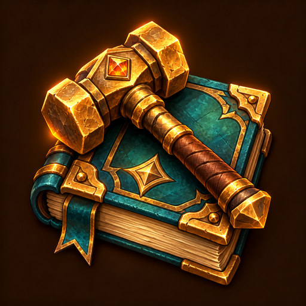

<p align="center"></p>
<h1 align="center">GabbaGuildCraft</h1>
<p align="center">Your recipes. Your guild. Ready to share.</p>
<p align="center"><a href="README.md">Deutsch</a> · <a href="https://github.com/Gabbajoe/GabbaGuildCraft/releases/latest">Download</a> · <a href="https://kellerkind.info/gabbacraft/">GabbaCraft</a></p>

Export your learned WoW Classic profession recipes with reagents, quantities, item stats and effects. Search and filter your recipes, copy Discord-sized messages, or prepare an HTML export for your guild's crafting website. Built for Saftladen on Soulseeker.

## Install

Download the **GabbaGuildCraft versioned ZIP** from Releases, not GitHub's source archive. Exit WoW, extract it and put the included `GabbaGuildCraft` folder into your game's `Interface/AddOns` directory.

```text
C:\Program Files (x86)\World of Warcraft\_classic_era_\Interface\AddOns\GabbaGuildCraft\GabbaGuildCraft.toc
```

Use Battle.net's folder-opening option to locate your actual installation. On Linux and macOS use the same relative folder structure. Restart WoW and enable the addon on character selection. Do not nest two `GabbaGuildCraft` directories.

The manifest targets Classic Era **1.15.9** and Burning Crusade Classic **2.5.6**, not Retail. Automated Lua tests cover the new controls with simulated WoW APIs; this release still needs an in-game smoke test. The addon's controls are in German; English item data is supported. The website has German and English display options.

## Share recipes

1. Open your profession and clear its filters.
2. Click the hammer/book minimap icon or type `/ggc` (`/gts` also works).
3. Click **Rezepte einlesen** (scan recipes); adjust search and relevance filters.
4. Click **HTML speichern** (save HTML), then **Neu laden** (reload UI). Reload is enabled after a successful save and is blocked during combat. Changing filters requires saving again.
5. Upload `WTF/Account/YOUR_ACCOUNT/SavedVariables/GabbaGuildCraft.lua` to **My workshop** on GabbaCraft. Use the correct account and not the `.bak` file. Uploads on the Saftladen website require its **Crafter** Discord role; reading recipe pages is public.
6. Share your recipe-page link. Repeat the export to update recipes or publish another profession.

For Discord-only exports, click **Text markieren**, copy with Ctrl+C, and use **Weiter** for additional pages. No login is required for the addon or copying text. The addon makes no network connections and does not upload automatically.

Drag the minimap icon to move it. Position is saved account-wide on reload/logout. Missing recipes usually mean a profession or addon filter is active; missing item data may need another scan after a short wait.

## Development

See [release instructions](RELEASING.md), [CurseForge setup](curseforge/SETUP.md) and [changelog](CHANGELOG.md). No external addon libraries required. The repository contains only the addon, not the website or Companion.

[MIT license](LICENSE). Original AI-assisted [artwork](docs/artwork/PROMPT.md). World of Warcraft is a trademark of Blizzard Entertainment; this community project is not affiliated with Blizzard.
